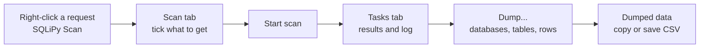

# SQLiPy

A Burp Suite extension that runs sqlmap scans through the sqlmap API, shows the results inside Burp and dumps databases.

> **Credits:** SQLiPy was created by **Josh Berry** ([codewatchorg/sqlipy](https://github.com/codewatchorg/sqlipy)).
> This repository continues it with version 0.9.0 by [Tr0j4n1](https://github.com/Tr0j4n1): a rebuilt UI and database dump support.
> The full original commit history is kept here.

## What's new in 0.9.0

- **New UI.** It resizes, follows Burp's theme and font size, and nothing is cut off.
- **Three tabs:** Scan, Tasks and API. Rarely used options are folded. One section opens at a time.
- **No freezes.** The API starts in the background. **Start scan** starts the API when it is not running.
- **Tasks tab.** Status, results, log and the equivalent sqlmap command of every task. Stop or remove a task.
- **Dump dialog.** List databases, list tables, dump a table, a database or everything. It reuses the sqlmap session, so detection does not run again.
- **Dumped data tab.** Every dumped table as a grid. Copy a cell, row, column or the whole table. Save as CSV.
- **Multi-table dumps.** SQLiPy reads every CSV file that sqlmap writes, from disk or through the API.
- **More places to start a scan.** Right-click **SQLiPy Scan** works in Proxy history, the site map, Repeater and message editors.
- **Remembers settings.** The Python and `sqlmapapi.py` paths stay after a Burp restart.

## How it works

## Requirements

- Burp Suite Community or Professional.
- Jython standalone 2.7.2. Do not use Jython 2.7.3. It has a bug that stops the extension.
- Python 3 (or 2.7) to run sqlmap.
- sqlmap. This repository includes it as `sqlmap.zip`. You can also use your own copy.

## Install

### Replace the BApp Store version

1. Install SQLiPy from the BApp Store.
2. Copy `SQLiPy.py` from this repository into the SQLiPy BApp folder:
   - Windows: `%APPDATA%\BurpSuite\bapps\f154175126a04bfe8edc6056f340f52e\`
   - Linux and macOS: `~/.BurpSuite/bapps/f154175126a04bfe8edc6056f340f52e/`
3. Open **Extensions → Installed**. Untick **SQLiPy Sqlmap Integration**, then tick it again.

### Load it manually

1. Set the Jython JAR in **Settings → Extensions → Python environment**.
2. Clone this repository. Unzip `sqlmap.zip`.
3. Open **Extensions → Installed** and click **Add**. Set the type to **Python** and select `SQLiPy.py`.
4. Open the **SQLiPy → API** tab. Set **Python** and **sqlmapapi.py** if they are empty.

## Use

1. Right-click a request and select **SQLiPy Scan**.
2. On the **Scan** tab, tick what to get. Click **Start scan**.
3. Follow the task on the **Tasks** tab.
4. Select a vulnerable task. Click **Dump...**.
5. Click **List databases**, then **List tables**, then **Dump**.
6. Open **Dumped data**. Right-click a cell to copy it, or click **Save CSV...**.

Only scan systems that you have permission to test.

## Notes

- **Microsoft Store Python** moves sqlmap's output folder to `%LOCALAPPDATA%\Packages\PythonSoftwareFoundation.Python.*\LocalCache\Local\sqlmap`. SQLiPy gets the dump files through the API, so dumps still show.
- **Burp Community** cannot add scanner issues. The results show on the Tasks tab only.
- **An API you started yourself:** enter its host and port on the API tab, then click **Start API**. SQLiPy connects to it.

## License

SQLiPy is released under the [Unlicense](LICENSE) (public domain), the same as the original.
sqlmap is GPLv2. See [`LICENSE - sqlmap`](LICENSE%20-%20sqlmap).
